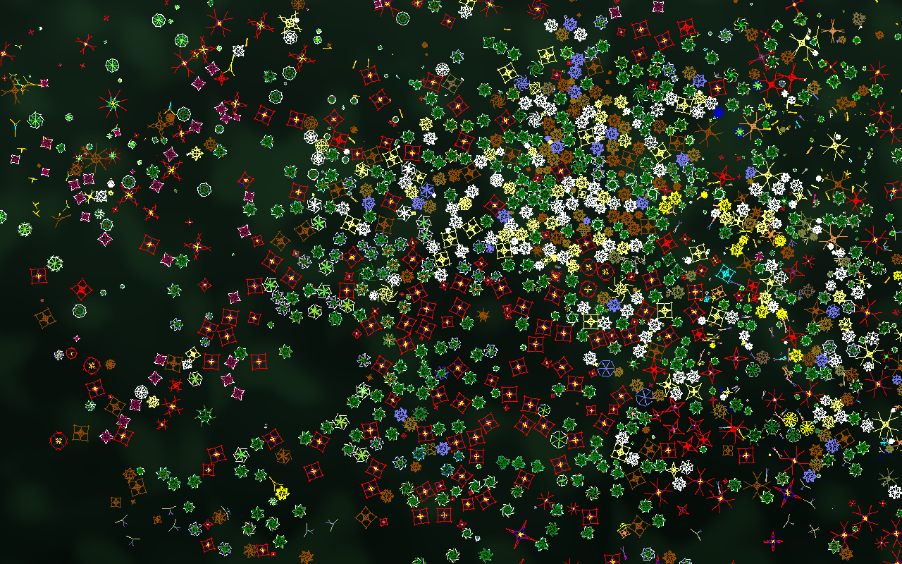
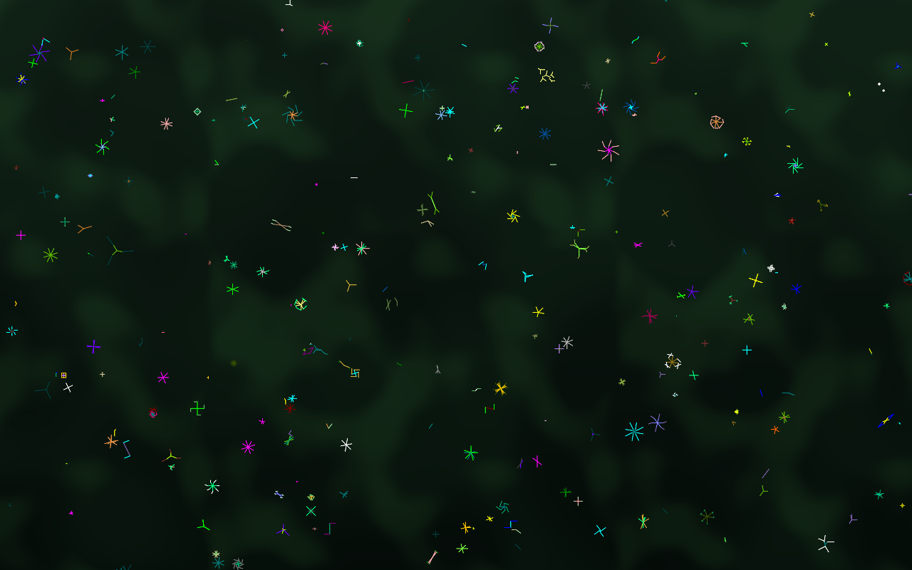
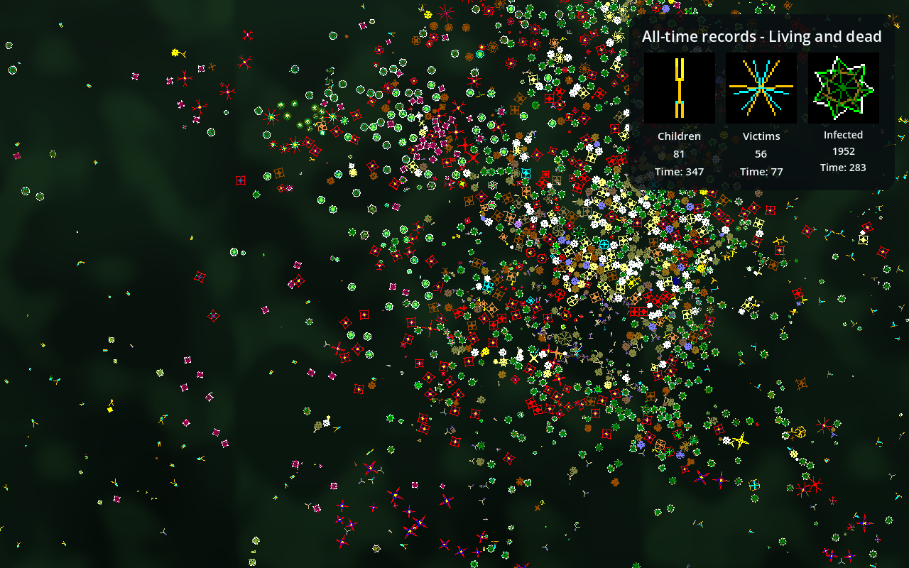

# Biogenesis-R

I love Biogenesis. I wanted it to run better, and I hate writing Java. Biogenesis-R is my Rust port of the simulation, with Godot handling the display and controls.

A big reason I built it was a Raspberry Pi 5 integrated into a touchscreen monitor. I wanted to wake up, glance over, and see a living world. Cinema mode turns it into a dynamic portrait. It drifts between scenic views, follows feeding when it happens, and occasionally shows the world records. The controls fade away when you leave it alone.

[Watch the Pi running Biogenesis-R (49 seconds)](docs/media/pi-living-portrait.mp4)

## In game

[Watch the underwater world (8 seconds)](docs/media/gameplay-world.mp4)  
[Watch the Cinema camera (8 seconds)](docs/media/gameplay-cinema.mp4)

## Build and run

[Build from source or set up fullscreen Cinema on a Raspberry Pi](docs/build.md).

## Credits

Joan Queralt Molina created the original Biogenesis. MarcoDBAA made Color Mod. Color Mod also incorporates work from Tyler Coleman's Features Mod. Their work is why this port exists.

[Original Biogenesis](https://sourceforge.net/projects/biogenesis/)  
[Biogenesis Color Mod](https://sourceforge.net/projects/biogenesiscolor/)  
[Biogenesis Features Mod](https://sourceforge.net/projects/biogenesisfeatu/)

## License

Biogenesis-R is available under GPLv2. The license text and original notices are in [COPYING](COPYING) and [NOTICE.legacy](NOTICE.legacy).

I want people to be able to get Biogenesis-R for free. If you redistribute it, please keep copies free and point people to this repository. This is a request. The GPLv2 terms govern use and redistribution.
